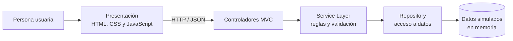

# Biblioteca digital comunitaria

## 1. Resumen de la arquitectura

La aplicación organiza sus responsabilidades en capas: presentación (HTML, CSS y JavaScript en `public/`), lógica de negocio (`src/services/`), acceso a datos (`src/repositories/`) y datos simulados en memoria (`src/data/`). Los controladores aplican MVC al coordinar las solicitudes HTTP y los servicios; los repositorios aíslan la lectura y escritura de los datos. El formulario de solicitud valida sus datos tanto en el navegador como en el servidor.

Esta separación se elige frente a un monolito sin límites internos porque facilita cambiar y probar cada responsabilidad sin acoplar la interfaz a las reglas o al almacenamiento. Frente a un cliente-servidor puro sin capas, evita concentrar validaciones y consultas en los controladores. Frente a microservicios, mantiene una solución sencilla de ejecutar y operar para una biblioteca pequeña, sin añadir despliegue distribuido ni comunicación de red entre servicios.

La escalabilidad mejora porque la capa de repositorio puede sustituirse por una base de datos real y los servicios pueden ampliarse sin rehacer la interfaz. La mantenibilidad se beneficia de responsabilidades explícitas y módulos pequeños. La seguridad se refuerza con validación en servidor, límite de tamaño del cuerpo, consultas de lectura codificadas, rutas estáticas restringidas al directorio público y cabeceras HTTP defensivas. Los datos de ejemplo y las solicitudes solo viven en memoria y se reinician al reiniciar el servidor.

## 2. Diagrama de componentes



## 3. Estructura de carpetas

```text
biblioteca-digital/
├── public/
│   ├── app.js
│   ├── data/
│   │   └── books.json
│   ├── index.html
│   └── styles.css
├── src/
│   ├── controllers/
│   │   ├── bookController.js
│   │   └── requestController.js
│   ├── data/
│   │   ├── books.js
│   │   └── requests.js
│   ├── repositories/
│   │   ├── bookRepository.js
│   │   └── requestRepository.js
│   ├── services/
│   │   ├── bookService.js
│   │   └── requestService.js
│   └── routes.js
├── .github/
│   └── workflows/
│       └── pages.yml
└── server.js
```

## 4. Código funcional completo

Los archivos de la estructura anterior contienen el código completo. No se requieren paquetes ni servicios externos: el servidor HTTP y los datos de demostración usan únicamente módulos integrados de Node.js.

## 5. Instrucciones para ejecutarlo

1. Instala Node.js 18 o posterior.
2. Desde la carpeta del proyecto, ejecuta `node server.js`.
3. Abre <http://localhost:3000>.
4. Explora el catálogo, busca o filtra por género e idioma, abre un libro y envía una solicitud.

Las rutas de detalle admiten enlaces directos. El endpoint `GET /api/books` acepta `search`, `category` y `language`; `GET /api/books/:id` consulta un libro y `POST /api/requests` registra una solicitud en memoria.

### Publicación en GitHub Pages

Cada push a `main` ejecuta `.github/workflows/pages.yml` y publica el frontend en <https://arielnoob24.github.io/tecnico/>. El catálogo estático lee `public/data/books.json`; al estar Pages limitado a contenido estático, el formulario muestra una confirmación de demostración y **no envía ni guarda datos personales**. El backend Node.js y el registro en memoria de solicitudes funcionan al ejecutar el servidor localmente, pero no se despliegan en Pages.
